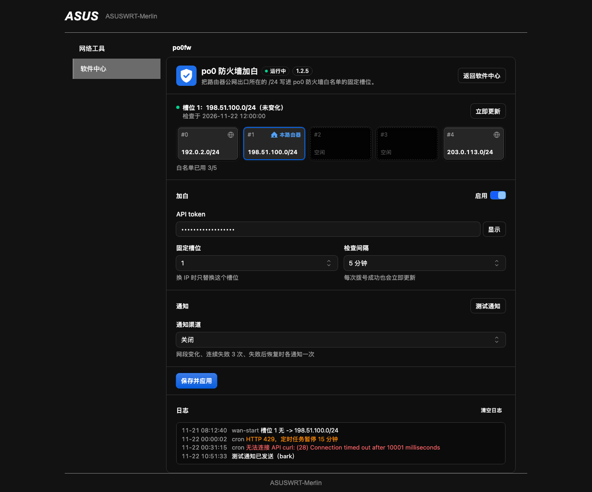
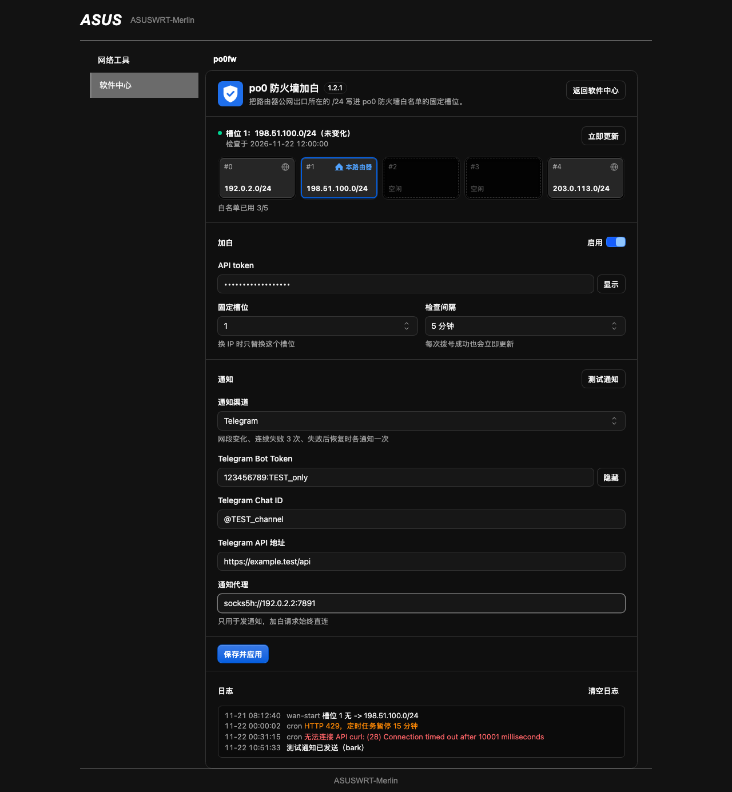

# ASUS Merlin 方案（KoolShare / KoolCenter 软件中心插件）

`po0fw/` 是软件中心插件，在路由器上维护家宽槽位，默认槽位为 1。拨号拿到的可能是运营商内网地址（CGNAT），公网 IP 也可能在不重拨的情况下变化。插件在拨号成功和定时任务两个触发点更新白名单。

设置都存在 dbus 的 `po0fw_*` 键里，在「软件中心 → po0 防火墙加白」页面里修改。状态和日志分别在 `/tmp/upload/po0fw_status.txt` 和 `/tmp/upload/po0fw_log.txt`，日志只记录变化和失败。

## 界面预览

截图来自仓库预览服务的 mock 数据，不是实际路由器截图。地址使用文档保留网段，token、Bark key、Telegram token 和代理都是示例值。页面固定深色。

| 场景 | 预览 |
|---|---|
| 桌面总览 |  |
| 桌面通知设置 |  |
| 桌面 Telegram 设置 |  |

## 安装与升级

1. 从 [GitHub Releases](https://github.com/zhdsmy/po0fw/releases) 下载 `po0fw-<版本>.tar.gz`。
2. 在软件中心选择「离线安装」，上传下载的 `po0fw-<版本>.tar.gz`。
3. 覆盖安装会保留现有设置。
4. 从 1.0.x 升级时，旧版「Bark 通知」开关依赖外部中转服务，1.1.0 起去掉了这个开关。升级后通知渠道默认为「关闭」，需要重新选择并填写。

已在 RT-AX86U（KoolCenter，hnd 平台）上验证。`.valid` 目前只写了 `hnd`，其他平台没有测试过。

## 设置说明

### 加白

- 启用开关同时控制定时任务和拨号成功（`wan-start`）后的立即更新。关闭后保存，状态显示「⏸ 已停用」。网页「立即更新」不受开关限制。
- API token 填 `pgnfw_` 开头的 token，不要带 `@槽位`。
- 固定槽位可选 0 到 9。换 IP 时只替换这个槽位。
- 检查间隔可选 1、2、5、10、15 或 30 分钟。启用时每次拨号成功也会立即更新。

### 通知渠道

通知渠道可选 Bark 或 Telegram。关闭通知时不发送消息。

| 渠道 | 设置 |
|---|---|
| Bark | Bark 地址，形如 `https://api.day.app/<key>`。自建服务器同样填完整地址 |
| Telegram | Bot Token、Chat ID。API 地址留空用 `https://api.telegram.org`，也可以填自建中转 |

「通知代理」只用于发通知，支持 `http://`、`https://`、`socks4(a)://`、`socks5(h)://`。加白请求始终直连，否则写进白名单的会是代理出口。路由器连不上 Telegram 官方地址时，填代理或 API 中转。

## 工作方式

### 触发点

- 拨号成功时，软件中心在 `wan-start` 调用 `/koolshare/init.d/S99po0fw.sh start`。脚本注册定时任务，并立即更新一次。
- 定时任务名为 `po0fw`，由 `cru` 执行，间隔在网页里设置，默认 5 分钟。
- 定时任务在前一次运行没结束时跳过。`wan-start` 和网页触发的更新会等前一次结束。

### 请求和错误处理

| 情况 | 处理 |
|---|---|
| 网络错误、HTTP 5xx | 间隔 5s、15s 再试两次，一次运行最长约 50 秒 |
| `403 pinned to another slot` | 家宽网段已在别的槽位，常见原因是手机在家时写进了自己的槽位。本槽位不改，状态显示 ⚠️，进入这个状态时记一次日志 |
| `429` 限频 | 定时任务暂停 15 分钟。`wan-start` 和网页「立即更新」不受影响 |
| 200 但 `enabled:false` | 按失败处理 |

错误响应体写进日志和状态前会去掉换行、截断，并把 token 打码成 `pgnfw_***`。

## 通知

### 发送时机

- 槽位网段变化时通知。首次记录不通知。发送失败时先不更新记录，下一轮重试。连续失败 3 轮后放弃这次通知，照常更新记录。
- 连续失败 3 轮时通知一次。发出过失败通知的，恢复后再通知一次。429 和定时任务跳过不算失败。通知渠道为「关闭」时不算发过失败通知，打开通知后下一轮失败照常通知。
- 网页「测试通知」会先保存通知设置，再发一条测试消息，结果写在日志里。

通知标题是「🛡️ po0 防火墙加白」。Bark 把摘要放在副标题、详情放在正文，图标用插件图标（`po0fw/res/icon-po0fw.png` 在本仓库的 raw 地址，iOS 15 及以上生效。手机下载不到时显示 Bark 默认图标）。Telegram 发三行，包括标题、摘要、详情。

| 情况 | 摘要 | 详情 |
|---|---|---|
| 槽位网段变化 | 🔄 出口网段已更新 · 📌 槽位 1 | `🌐 旧网段 → 新网段` |
| 连续失败 3 轮 | 🚨 连续 3 次加白失败 | 当前状态，例如 `❌ HTTP 400` |
| 失败后恢复 | 🎉 已恢复 | 当前状态，例如 `✅ 槽位 1：…` |
| 测试通知 | 🔔 测试通知 | 当前状态 |

## 安全提示

Bark key 和 Telegram Bot Token 以明文存在路由器的 dbus 里，API token 也以明文存在。能登录路由器后台的人都能看到。

## 开发

### 测试、构建与发布

```sh
asus-merlin/test.sh    # 在 busybox 1.25 容器里用 mock 跑 po0fw_config.sh 的回归用例（需要 docker）
asus-merlin/build.sh   # 生成 dist/po0fw-<版本>.tar.gz
```

发布新版本时先改 `po0fw/version`，提交到 `main` 后推送 tag `asus-merlin/v<版本>`，例如 `asus-merlin/v1.1.0`。GitHub Actions 会检查 tag 在 `main` 上且与版本号一致，然后构建安装包并上传到 Release。

在仓库根目录运行 `asus-merlin/build.sh` 后，执行 `sh asus-merlin/web/test/install-upgrade.sh`，可在断网 BusyBox 1.25 容器中复测覆盖安装与卸载。

### 网页前端

`asus-merlin/web/src/` 存放 React、Kumo 与 Tailwind 源码。ASUS 外框保留在 `po0fw/webs/Module_po0fw.asp`，组件和弹层都挂载在 Shadow DOM，页面固定深色。

在 `asus-merlin/web/` 下使用 Node.js 22.18 或更高版本运行：

```sh
npm ci
npm run typecheck
npm run build
npm run preview        # 终端给出本地网址，Ctrl-C 停止
npm test               # 在另一个终端运行，自动启动隔离的 mock
npm run screenshots    # 生成 ../docs/images/ 下的 README 预览图
```

预览使用本地 ASUS 外框桩、假配置和内存接口。测试需要 Playwright 对应的 Chromium，可用 `npx playwright-core install chromium` 安装。截图脚本使用相同的预览服务、随机端口和 `reducedMotion: "reduce"`，等待页面数据加载完成后生成 PNG。

构建将 JS 和 CSS 的联合内容摘要写入两个文件名，并在 `web/dist/Module_po0fw.asp` 引用相应脚本。打包与预览共用生成页和 `po0fw/res/` 中的资源。Shadow DOM 加载同名的 CSS，两条路径均不带查询串。覆盖安装切换页面后会删除旧版资源。
