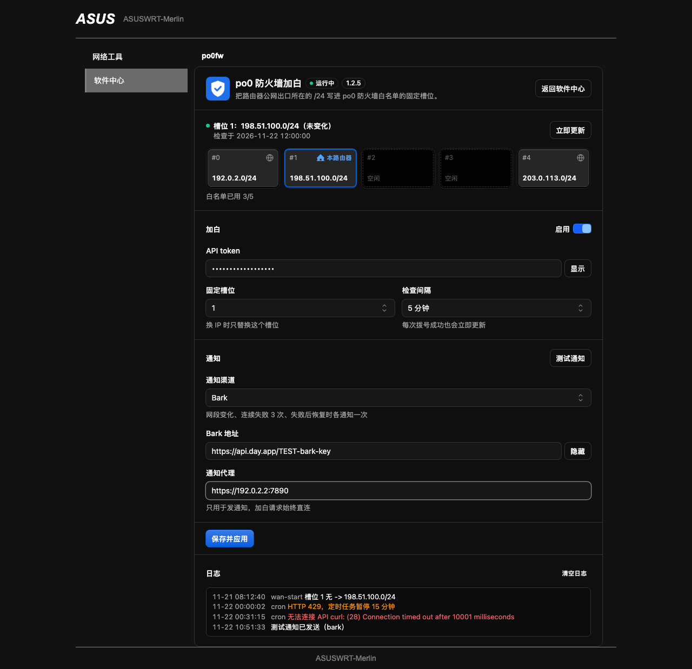

# ASUS Merlin 方案（KoolShare / KoolCenter 软件中心插件）

`po0fw/` 是运行在路由器上的软件中心插件，用于维护家宽槽位，默认槽位为 1。拨号拿到的可能是运营商内网地址（CGNAT），公网 IP 也可能在不重拨的情况下变化。为此，插件在拨号成功和定时任务两个触发点更新白名单。

所有设置均保存在 dbus 的 `po0fw_*` 键中，可在「软件中心 → po0 防火墙加白」页面修改。状态和日志分别写入 `/tmp/upload/po0fw_status.txt` 和 `/tmp/upload/po0fw_log.txt`，其中日志只记录变化和失败。

## 界面预览

以下截图取自仓库预览服务的 mock 数据，并非实际路由器截图。图中地址为文档保留网段，token、Bark key、Telegram Bot Token 和通知代理均为示例值。页面固定为深色。

| 场景 | 预览 |
|---|---|
| 桌面总览 |  |
| 桌面通知设置 |  |
| 桌面 Telegram 设置 |  |

## 安装与升级

1. 从 [GitHub Releases](https://github.com/zhdsmy/po0fw/releases) 下载 `po0fw-<版本>.tar.gz`。
2. 在软件中心选择「离线安装」，上传 `po0fw-<版本>.tar.gz`。
3. 覆盖安装会保留现有设置。
4. 从 1.0.x 升级时需注意：旧版「Bark 通知」开关依赖外部中转服务，1.1.0 起已移除。升级后通知渠道默认为「关闭」，需重新选择并填写。

已在 RT-AX86U（KoolCenter，hnd 平台）上验证。`.valid` 目前仅包含 `hnd`，其他平台尚未测试。

## 设置说明

### 加白

- 启用开关同时控制定时任务和拨号成功（`wan-start`）后的立即更新。关闭并保存后，状态显示「⏸ 已停用」。网页中的「立即更新」不受此开关限制。
- API token 填写 `pgnfw_` 开头的 token，不要带 `@槽位`。
- 固定槽位可选 0 到 9，换 IP 时只替换该槽位。
- 检查间隔可选 1、2、5、10、15 或 30 分钟。

### 通知渠道

通知渠道可选 Bark 或 Telegram；选择「关闭」时不发送消息。

| 渠道 | 设置 |
|---|---|
| Bark | Bark 地址，形如 `https://api.day.app/<key>`；自建服务器同样填写完整地址 |
| Telegram | Bot Token、Chat ID；API 地址留空时使用 `https://api.telegram.org`，也可填写自建中转 |

「通知代理」只用于发送通知，支持 `http://`、`https://`、`socks4(a)://`、`socks5(h)://`。加白请求始终直连，否则写入白名单的会是代理出口。路由器无法连接 Telegram 官方地址时，可填写通知代理或 API 中转。

## 工作方式

### 触发点

- 拨号成功（`wan-start`）时，软件中心调用 `/koolshare/init.d/S99po0fw.sh start`，注册定时任务并立即更新一次。
- 定时任务名为 `po0fw`，由 `cru` 执行，检查间隔在网页中设置，默认 5 分钟。
- 若前一次更新尚未结束，定时任务会跳过本次执行；`wan-start` 和网页触发的更新则会等待前一次结束。

### 请求和错误处理

| 情况 | 处理 |
|---|---|
| 网络错误、HTTP 5xx | 间隔 5s、15s 各重试一次，单次运行最长约 50 秒 |
| `403 pinned to another slot` | 家宽网段已在其他槽位（常见原因是手机在家时写入了自己的槽位）。本槽位保持不变，状态显示 ⚠️，仅在进入该状态时记录一次日志 |
| `429` 限频 | 定时任务暂停 15 分钟；`wan-start` 和网页「立即更新」不受影响 |
| 200 但 `enabled:false` | 按失败处理 |

错误响应体写入日志和状态前，会先去除换行并截断，同时将 token 替换为 `pgnfw_***`。

## 通知

### 发送时机

- 槽位网段变化时发送通知，首次记录不通知。若通知发送失败，暂不更新网段记录并在下一轮重试；连续失败 3 轮后放弃本次通知，照常更新记录。
- 加白连续失败 3 轮时通知一次；发出过失败通知时，恢复后再通知一次。429 限频和定时任务跳过不计入失败。通知渠道为「关闭」时不会标记为已通知，开启后若下一轮仍失败会照常通知。
- 点击网页中的「测试通知」会先保存通知设置，再发送一条测试消息，结果记录在日志中。

通知标题统一为「🛡️ po0 防火墙加白」。Bark 将摘要作为副标题、详情作为正文，图标取自本仓库 `po0fw/res/icon-po0fw.png` 的 raw 地址（iOS 15 及以上生效，手机下载失败时回退为 Bark 默认图标）。Telegram 按三行依次发送标题、摘要和详情。

| 情况 | 摘要 | 详情 |
|---|---|---|
| 槽位网段变化 | 🔄 出口网段已更新 · 📌 槽位 1 | `🌐 旧网段 → 新网段` |
| 连续失败 3 轮 | 🚨 连续 3 次加白失败 | 当前状态，例如 `❌ HTTP 400` |
| 失败后恢复 | 🎉 已恢复 | 当前状态，例如 `✅ 槽位 1：…` |
| 测试通知 | 🔔 测试通知 | 当前状态 |

## 安全提示

API token、Bark key 和 Telegram Bot Token 均以明文保存在路由器的 dbus 中，任何能登录路由器后台的人都可查看。

## 开发

### 测试、构建与发布

```sh
asus-merlin/test.sh    # 在 busybox 1.25 容器里用 mock 跑 po0fw_config.sh 的回归用例（需要 docker）
asus-merlin/build.sh   # 生成 dist/po0fw-<版本>.tar.gz
```

发布新版本时，先更新 `po0fw/version` 并提交到 `main`，再推送 tag `asus-merlin/v<版本>`（例如 `asus-merlin/v1.1.0`）。GitHub Actions 会校验该 tag 位于 `main` 且与版本号一致，随后构建安装包并上传至 Release。

在仓库根目录运行 `asus-merlin/build.sh` 后，可执行 `sh asus-merlin/web/test/install-upgrade.sh`，在断网的 BusyBox 1.25 容器中验证覆盖安装与卸载。

### 网页前端

`asus-merlin/web/src/` 存放 React、Kumo 与 Tailwind 源码。ASUS 页面外框保留在 `po0fw/webs/Module_po0fw.asp`，组件和弹层均挂载在 Shadow DOM 中。

在 `asus-merlin/web/` 目录下，使用 Node.js 22.18 或更高版本运行：

```sh
npm ci
npm run typecheck
npm run build
npm run preview        # 终端给出本地网址，Ctrl-C 停止
npm test               # 在另一个终端运行，自动启动隔离的 mock
npm run screenshots    # 生成 ../docs/images/ 下的 README 预览图
```

预览服务使用本地 ASUS 外框桩、模拟配置和内存接口。测试依赖 Playwright 对应的 Chromium，可通过 `npx playwright-core install chromium` 安装。截图脚本复用同一预览服务，监听随机端口并启用 `reducedMotion: "reduce"`，待页面数据加载完成后生成 PNG。

构建时会计算 JS 和 CSS 的联合内容摘要并写入各自文件名，再在 `web/dist/Module_po0fw.asp` 中引用生成的脚本；Shadow DOM 会加载同名 CSS，JS 和 CSS 路径均不带查询串。打包与预览共用这份生成页面和 `po0fw/res/` 中的资源。覆盖安装切换页面后，会删除旧版资源。
